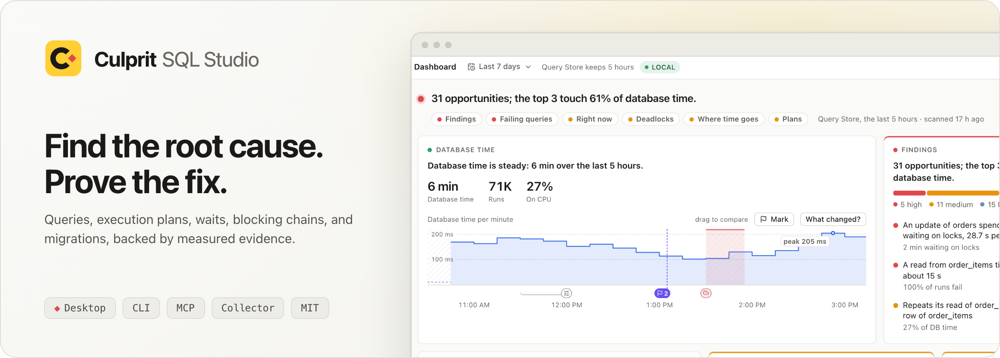

<p align="center">
  <a href="https://culpritsql.com">
    <picture>
      <source media="(prefers-color-scheme: dark)" srcset="https://raw.githubusercontent.com/culpritsql/.github/main/profile/banner-dark.png">
      
    </picture>
  </a>
</p>

<p align="center">
  Open-source performance diagnostics and root-cause analysis for relational databases.
</p>

<p align="center">
  
  
  
  
  
  
  
  
</p>

<p align="center">
  <a href="https://culpritsql.com">culpritsql.com</a> ·
  <a href="https://github.com/culpritsql/culprit-sql-studio/blob/main/docs/guide.md">Guide</a> ·
  <a href="https://github.com/culpritsql/culprit-sql-studio/blob/main/docs/ARCHITECTURE.md">Architecture</a> ·
  <a href="https://github.com/culpritsql/culprit-sql-studio/blob/main/docs/agents.md">Coding Agents (MCP)</a> ·
  <a href="https://github.com/culpritsql/culprit-sql-studio/blob/main/docs/collector.md">Collector &amp; ADX</a> ·
  <a href="https://github.com/culpritsql/culprit-sql-studio/releases/latest">Releases</a>
</p>

#### Two ways to run it

| Mode | How it works |
| :--- | :--- |
| **Direct**<br><sub>Desktop · CLI · MCP</sub> | Connect directly to a database (or open a saved snapshot offline) to inspect top queries, ranked findings, execution plans, live blocking, virtual indexes, and SQL migrations in CI or coding agents. |
| **Fleet Collector**<br><sub>ADX · ClickHouse</sub> | Deploy a bounded container in your database network and push verified telemetry and synthesized root-cause findings to **Azure Data Explorer (ADX)** or **ClickHouse** (with Blob or S3 recovery). |

#### What it diagnoses

- **Top queries by database time, wait attribution & ranked findings**
- **Execution plan regressions, parameter sensitivity & side-by-side plan diffs**
- **`@TVP` cardinality skew, memory-grant starvation & disk spills**
- **Page-latch (`PAGELATCH`) hot pages & `tempdb` allocation contention**
- **Blocking chains, DDL metadata-lock sandwiches & deadlocks**
- **Worker-thread (`THREADPOOL`) & compiler-gateway starvation**
- **PostgreSQL subtransaction (`SubtransSLRU`) & `XID` wraparound cliffs**
- **Transaction-log stalls, slow client consumers & replica redo blocks**
- **Version-store (`PVS` / vacuum) retention & cloud tier throttling**
- **Missing/unused indexes & unsafe SQL migrations in pull requests**

#### Alert on root causes directly from ADX

Point an Azure Monitor Scheduled Query Rule or Grafana alert at ADX to page on-call with the culprit and fix already attached:

```kql
// Runs every 1m in Azure Monitor / Grafana -> PagerDuty, Slack, or Teams
CulpritIncidentsV1
| where UpdatedAt > ago(5m) and Status == "active" and Severity == "high"
| project StartedAt, DatabaseName, CulpritKind, Headline, CulpritSql, DeveloperAction
```
